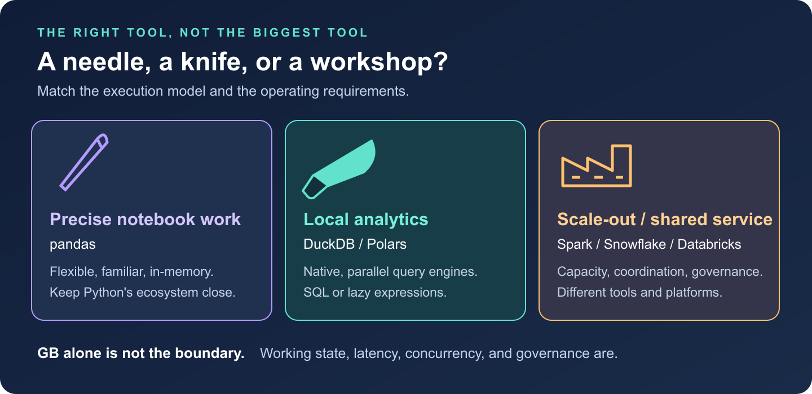
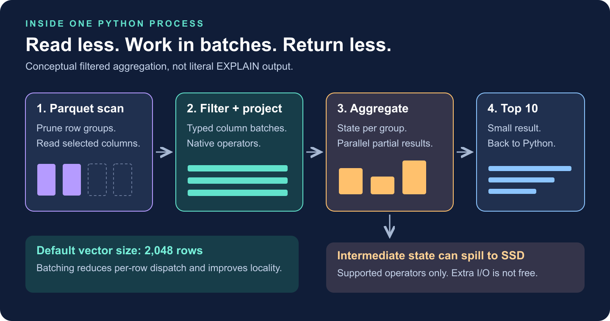
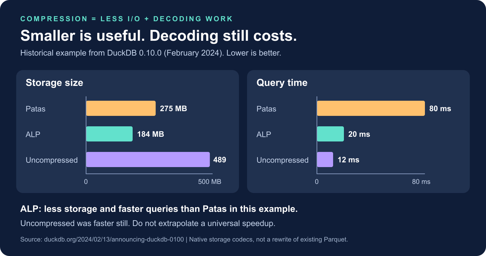

# DuckDB: Big Analytics, Small Footprint

You have 20 GB of event data and one question: which markets generated the most revenue last month? Reaching for a Spark cluster is understandable. It is not always necessary.

**Several gigabytes is a data size, not a distributed-systems requirement.** Before distributing the work, check whether one machine can scan less data, execute efficiently, and keep intermediate state under control.

DuckDB makes that a practical starting point: an analytical SQL database you can import into Python and run locally. No cluster, driver service, or network hop is required.



## 1. The philosophy: bring the engine to the data

Think of pandas as a needle: excellent for precise, flexible work inside a notebook. DuckDB is a chef's knife: comfortable slicing through substantial relational datasets. Spark and managed data platforms are the workshop: valuable when the job needs more capacity, coordination, or shared infrastructure.

DuckDB's core design combines **embedded execution** with **column-oriented analytics**. The engine runs inside your Python process; SQL plans execute in native code, rather than as Python row loops. It can query Parquet, CSV, and in-memory DataFrames without first loading everything into a database table.

It optimizes for scans, joins, aggregations, and windows, rather than high-concurrency application transactions. This article uses embedded DuckDB; newer releases also support client-server operation. [1]

## 2. Why it is fast: less work, then better execution

For a monthly revenue query, the important work happens before the first sum:

- **Projection pushdown:** read the required columns, not every field.
- **Filter pushdown:** apply supported predicates at the scan; Parquet statistics can eliminate irrelevant row groups. Hive-style partitions can eliminate whole files.
- **Vectorized execution:** process batches of column values through native operators, rather than dispatching an operator call for every row.

Imagine each event has 40 columns. Our query needs four, including its filter columns. Parquet lets DuckDB avoid reading the other 36, rather than load and discard them. Date pruning helps most when row groups cover narrow date ranges; if every group spans the whole year, a September filter may skip very little.



DuckDB's documented default vector size is **2,048 rows**. Processing typed column batches reduces per-row overhead and improves CPU-cache locality. Multiple threads can process different chunks. Some operations exploit SIMD instructions, but vectorization does not mean every expression becomes one hardware instruction. [2]

The optimizer chooses operators and join order. `EXPLAIN ANALYZE` reveals what actually ran. A clever codec will not rescue an accidental many-to-many join.

## 3. Several GB of Parquet, one Python process

For reproducibility, install `python -m pip install duckdb==1.4.5`. Suppose `events/` contains Parquet with timestamp `event_time`, string `country` and `event_type`, and integer `amount_cents`, normalized to one reporting currency.

No dataset handy? Download the [demo generator](/scripts/benchmark_duckdb_blog.py) and run:

```bash
python benchmark_duckdb_blog.py --generate-only --rows 5000000
```

It creates four files in a new `events/` folder, refusing to overwrite an existing one. Run this query from the same directory:

```python
import duckdb

query = """
    SELECT country,
           SUM(amount_cents) / 100.0 AS revenue
    FROM read_parquet('events/*.parquet')
    WHERE event_time >= TIMESTAMP '2026-09-01'
      AND event_time <  TIMESTAMP '2026-10-01'
      AND event_type = 'purchase'
    GROUP BY country
    ORDER BY revenue DESC, country
    LIMIT 10
"""

with duckdb.connect() as con:
    con.execute("SET threads = 4")
    con.execute("SET memory_limit = '4GB'")
    con.execute("SET temp_directory = './duckdb-spill'")
    con.execute("SET max_temp_directory_size = '20GB'")

    print(con.execute(query).fetchall())
    # This executes the query again to collect its profile.
    print(con.execute("EXPLAIN ANALYZE " + query).fetchone()[1])
```

The demo's top row is `('C27', 6952347.9)`: synthetic market C27, September revenue of 6,952,347.90. Here is a shortened reading of its actual profile:

```text
TABLE_SCAN: 4 files; date and purchase filters; 407,208 rows out
  -> HASH_GROUP_BY: country; SUM(amount_cents); 30 groups out
  -> TOP_N: revenue descending; 10 rows out
```

Those scan rows are **matches emitted**, not proof that only 407,208 rows were examined. The scan reads filter columns, passes country/amount onward, and excludes the unused payload. That is pushdown made visible.

The settings are illustrative: leave RAM for Python and the OS, and use a writable SSD with enough spill space. `memory_limit` is not a hard ceiling on total process memory.

**The input does not have to fit in RAM; the working state matters.** A scan grouped into 30 countries needs little aggregation state. Grouping by hundreds of millions of distinct user IDs is a different workload.

DuckDB streams input and can spill supported joins, sorts, and aggregations to disk. Spilling costs I/O; some query shapes can still run out of memory. [3]

Also distinguish compressed file size from expanded data and working state: “20 GB” alone cannot predict RAM use. Return small results; use `COPY (SELECT ...) TO 'result.parquet' (FORMAT PARQUET)` for large outputs instead of materializing everything with `.df()`.

## 4. Compression is an execution decision

Compression can make queries faster because moving bytes is expensive. But the smallest file is not automatically the fastest: decoding costs CPU.

DuckDB's native storage chooses encodings per column segment: **run-length/dictionary encoding** for repetition, **bit-packing/frame-of-reference** for small integer ranges, and **FSST** for strings. Different patterns deserve different tools. [4]

For floating-point columns, **ALP (Adaptive Lossless Floating-Point Compression)** arrived in DuckDB 0.10.0. It exploits decimal-like structure where suitable, with exception/fallback paths that preserve values exactly. [5]



In that historical example, ALP was smaller and faster than Patas; uncompressed execution was faster still. **Compression pays when saved data movement outweighs decoding work.**

Querying existing Parquet does **not** rewrite it with native DuckDB codecs. Parquet's own encodings and page compression apply there.

## 5. DuckDB, pandas, Polars, or Dask?

| Tool | Start here when... | Watch for... |
|---|---|---|
| pandas | Data fits comfortably; exploratory manipulation and Python-library compatibility dominate. | Eager intermediates and object-heavy columns can inflate memory. Vectorized pandas is not a Python row loop. |
| DuckDB | The question is naturally SQL: joins, aggregations, windows, and file-based analytics. | Large intermediate state, result materialization, and the limits of one host. |
| Polars | You prefer a DataFrame expression API with a lazy, parallel query engine. | Use lazy scans for pushdown; streaming support and memory needs depend on the query. |
| Dask | You need partitioned Python/DataFrame computation, custom task graphs, or a path to multiple workers. | Scheduling and shuffle overhead; tiny partitions can cost more than the computation. |

Polars also supports pushdown and streaming for supported larger-than-memory workloads. Dask can run locally too. [6]

**One measured comparison, not a leaderboard.** I ran the query above on 5 million null-free synthetic rows: four files totaling **114.4 MB compressed**, with **228.9 MB of uncompressed Parquet pages**. Neither figure represents DataFrame RAM use.

Hardware: Apple M5 Max, 48 GiB RAM, local storage; Python 3.11.16, PyArrow 26.0.0. Native thread pools were capped at four where configurable; pandas aggregation was not made parallel.

| Engine/version | First query | Repeat query | Peak process RSS |
|---|---:|---:|---:|
| DuckDB 1.4.5 | 178.3 ms | 18.3 ms | 129 MiB |
| pandas 3.0.6 | 67.0 ms | 41.5 ms | 389 MiB |
| Polars 2.0.0 | 17.7 ms | 15.5 ms | 140 MiB |
| Dask 2026.8.0 | 32.1 ms | 23.6 ms | 390 MiB |

Each engine used a fresh process and two timed read/filter/group/sort/materialize runs, excluding imports. pandas/PyArrow and Dask received scan filters and column selections; Polars used lazy streaming, Dask local threads and Arrow filesystem. Sorted results agreed within floating-point tolerance. RSS includes imports and is the lifetime peak across both runs.

**Polars was fastest here; DuckDB used the least peak memory.** DuckDB's first query cost is visible, not discarded. These are single observations with no OS-cache flush, not cold-storage measurements or a larger-than-RAM/spill test. They establish no universal winner.

Download the script and [raw measurements/profile](/assets/duckdb/benchmark-results.json); `uv run benchmark_duckdb_blog.py` uses pinned dependencies. Increase `--rows` for larger inputs, with a fresh `--directory`. For broader workloads, the historical [H2O.ai benchmark](https://duckdb.org/2023/11/03/db-benchmark-update.html) adds join/group-by evidence, not laptop predictions. [7]

## 6. When the workshop earns its keep

**Spark:** when a representative workload exceeds one suitable machine's memory, disk, or runtime budget, or needs distributed recovery. Spark also has local mode.

**Snowflake:** a shared analytical service with governance, concurrent BI, workload isolation, and elastic compute. You are buying an operating model, not just faster `GROUP BY`; cluster administration is already managed. [8]

**Databricks:** a governed lakehouse spanning engineering, streaming, SQL, and ML. It is a platform, not a synonym for Spark; Databricks SQL and vectorized Photon matter too. Managed/serverless options reduce infrastructure work. [9]

These capabilities overlap. A small, sensitive dataset shared across teams can justify a platform; a large local scan may not.

**My default:** DuckDB for SQL-shaped local analysis; Polars for expression-shaped transformations. Move when measurements or operating requirements demand it. If authoritative data already lives in a governed warehouse, query it there before downloading it.

Choose the needle, the knife, or the workshop by the job. The staff-engineering decision is not which tool can do the most. It is which one meets the requirement with the least total complexity.

## Sources

1. [DuckDB 2.0: embedded origins and Quack client-server support](https://duckdb.org/2026/10/21/announcing-duckdb-200.html).
2. [DuckDB execution format and vectors](https://duckdb.org/docs/1.4/internals/vector.html).
3. [DuckDB memory management: streaming, spilling, and limitations](https://duckdb.org/2024/07/09/memory-management.html).
4. [Lightweight compression in DuckDB](https://duckdb.org/2022/10/28/lightweight-compression.html).
5. [DuckDB 0.10.0: ALP and the published compression measurements](https://duckdb.org/2024/02/13/announcing-duckdb-0100.html#adaptive-lossless-floating-point-compression-alp).
6. [Polars lazy and streaming execution](https://docs.pola.rs/user-guide/lazy/execution/).
7. [H2O.ai benchmark update: hardware, methodology, and limitations](https://duckdb.org/2023/11/03/db-benchmark-update.html).
8. [Snowflake architecture and managed-service model](https://docs.snowflake.com/en/user-guide/intro-key-concepts).
9. [Databricks Photon: vectorized execution and platform integration](https://docs.databricks.com/aws/en/compute/photon).
